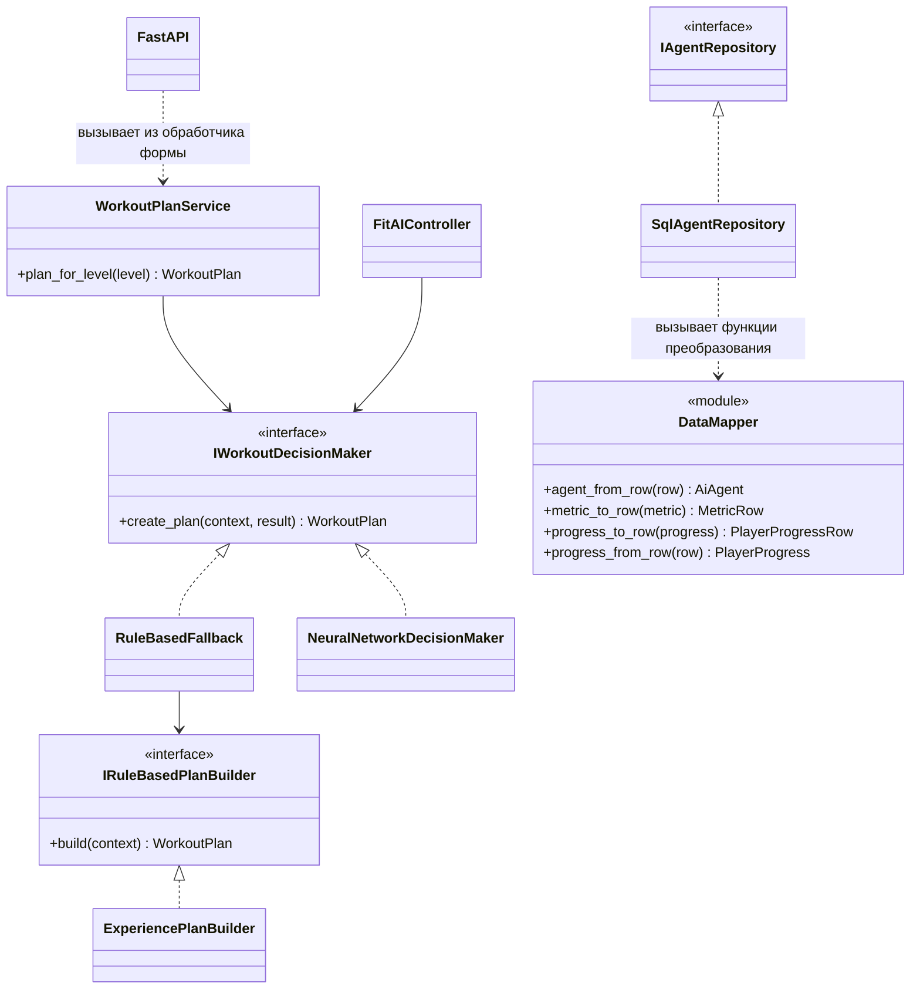

# Лабораторная работа №5. Паттерны проектирования ПО

## Цель

Применить паттерны GoF и Мартина Фаулера на примере FitCalc и сделать
формирование плана тренировки доступным через FastAPI и Jinja2.

## Исходная архитектура

`fitai.domain` содержит доменные модели и контракт хранения. Слой Application
содержит `FitAIController`, порты сервисов и стратегии выбора плана. Infrastructure
предоставляет ONNX-адаптер и SQLAlchemy-репозиторий. Контроллер уже получал
зависимости через конструктор и вызывал стратегии через общий интерфейс.
Репозиторий совмещал запросы и транзакции с преобразованием строк базы.

## Паттерны и рефакторинг

| Паттерн | Реализация и назначение |
| --- | --- |
| Strategy (GoF) | `NeuralNetworkDecisionMaker` и `RuleBasedFallback` реализуют контракт `IWorkoutDecisionMaker`. `WorkoutPlanService` использует тот же порт, что и `FitAIController`. |
| Adapter (GoF) | Существующий `RuleBasedFallback` адаптирует интерфейс `build(context)` к контракту `create_plan(context, result)`. Новый `ExperiencePlanBuilder` подключается через этот адаптер. |
| Repository (Фаулер) | Существующий `SqlAgentRepository` реализует `IAgentRepository` и управляет запросами и транзакциями. |
| Data Mapper (Фаулер) | Модуль `fitai.infrastructure.data_mapper` преобразует строки агентов в доменные объекты, метрики в строки, а прогресс — в обоих направлениях. Репозиторий по-прежнему управляет обновлением связанных строк агента и параметров в транзакции. |
| Dependency Injection | Стратегия передаётся в конструктор `WorkoutPlanService`. В точку сборки `create_app` можно передать готовый сервис, например в тестах. |

`create_app` служит фабричной функцией и собирает приложение с реализациями по
умолчанию. Для GoF Factory Method потребовалась бы иерархия создателей. Текущему
приложению достаточно одной фабричной функции и подмены сервиса через аргумент.

## Архитектура после изменений



## FastAPI и Jinja2

Точка входа — `fitai.web.app:app`. Запуск после установки зависимостей по README:

```bash
python -m uvicorn fitai.web.app:app
```

`GET /` показывает форму с тремя уровнями подготовки. `POST /` проверяет
выбранный уровень, вызывает сервис и возвращает страницу со списком упражнений и
условной интенсивностью. Для отсутствующего или неизвестного значения сервер
возвращает ту же форму с сообщением об ошибке и кодом 422.

Форма использует общий план по уровню. Сервис создаёт демонстрационный контекст
для существующего порта стратегии. Стандартный построитель читает из него
только уровень подготовки. Веб-сценарий работает на стратегии правил без
ONNX-модели. Полный процесс с профилем, питанием и инференсом остаётся в
`FitAIController`.

## Тестирование

```bash
python -m unittest discover -s tests -v
```

Прошли 26 тестов. Новые тесты проверяют выбор каждого уровня, отрисовку плана,
обработку неверного и пустого значения и передачу управления внедрённой
стратегии. Существующие тесты проверяют контроллер, стратегии, ONNX-адаптер,
миграции и чтение и запись данных через SQLite-репозиторий.

## Вывод

Приложение формирует планы через существующий контракт стратегии. Точка
сборки позволяет подменять сервис, а Data Mapper выделяет преобразования базы
данных в отдельный модуль.
