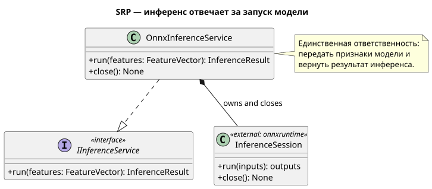
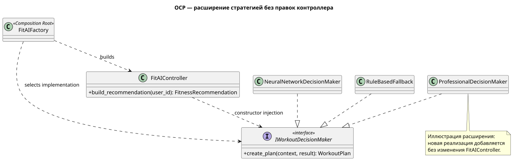
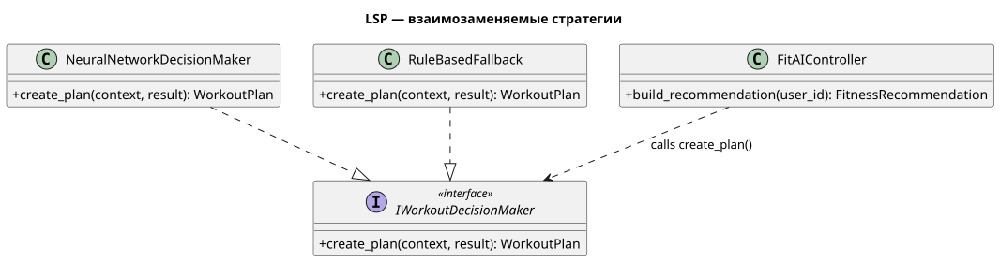
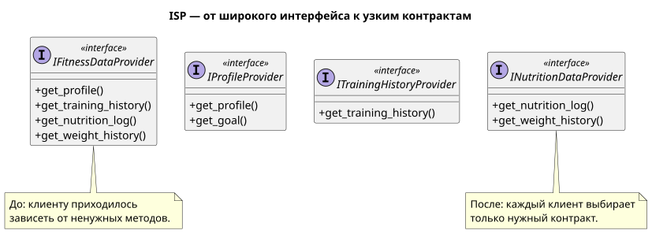
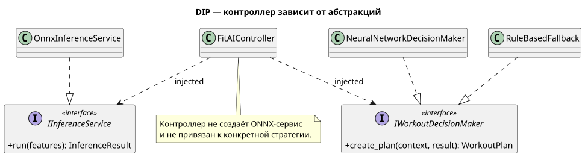

# Пояснительная записка: SOLID в модуле FitAI

## Назначение и границы реализации

FitAI получает пользовательские данные, готовит вход для модели, формирует рекомендации по тренировкам и питанию и передаёт результат приложению FitCalc. В проекте уже реализованы доменные типы, ONNX-адаптер, контрактные интерфейсы Application-слоя, контроллер и две стратегии принятия решений. Внешние API-адаптеры, прикладные алгоритмы рекомендаций и Composition Root пока не реализованы; места, где они показаны на общей UML-диаграмме как проектируемые компоненты, не следует принимать за готовый исполняемый код.

Проверка текущего кода: `python3 -m unittest discover -s tests -v` — 14 тестов проходят.

## SRP — принцип единственной ответственности

**Определение.** У класса должна быть одна основная ответственность и, соответственно, одна причина для изменения.

**Фрагмент UML**



**Фрагмент кода** — `fitai/infrastructure/onnx_inference_service.py`:

```python
def run(self, features: FeatureVector) -> InferenceResult:
    if self._closed:
        raise RuntimeError("Cannot run inference after the ONNX session is closed")

    import numpy

    tensor = numpy.asarray([features.values], dtype=numpy.float32)
    try:
        outputs = self._session.run(None, {self._input_name: tensor})
    except RuntimeError as error:
        raise InferenceUnavailableError("ONNX model execution failed") from error
    if len(outputs) != 1:
        raise RuntimeError(f"Expected one ONNX output tensor, got {len(outputs)}")
    scores = numpy.asarray(outputs[0]).reshape(-1).tolist()
    return InferenceResult(tuple(scores))
```

`OnnxInferenceService` подготавливает входной тензор для ONNX Runtime, вызывает модель и упаковывает её результат. Он не загружает данные FitCalc, не строит план тренировки и не интерпретирует значения результата. Управление временем жизни сессии (`close()` и контекстный менеджер) относится к ресурсу, которым владеет этот же адаптер.

**Если нарушить принцип.** Если добавить в этот сервис запросы к FitCalc, расчёт признаков и бизнес-правила выбора нагрузки, изменение API, формата входных данных или правил тренировок затронет один перегруженный класс. Например, замена ONNX на другой формат потребует менять не только вызов модели, но и несвязанные с ним алгоритмы.

## OCP — принцип открытости/закрытости

**Определение.** Компонент открыт для расширения новым поведением, но закрыт для постоянных изменений уже работающего кода.

**Фрагмент UML**



**Фрагмент кода** — зависимость контроллера задаётся контрактом в `fitai/application/controller.py`:

```python
class FitAIController:
    def __init__(
        self,
        *,
        # ...
        decision_maker: IWorkoutDecisionMaker,
        # ...
    ) -> None:
        self._decision_maker = decision_maker

    def build_recommendation(self, user_id: str) -> FitnessRecommendation:
        # ...
        workout_plan = self._decision_maker.create_plan(context, inference_result)
```

Контроллер вызывает одну операцию абстракции и не проверяет, какая именно стратегия ему передана. Уже есть `NeuralNetworkDecisionMaker` и `RuleBasedFallback`. Новую стратегию можно написать как реализацию `IWorkoutDecisionMaker`, а затем передать её при создании контроллера.

**Важно о состоянии проекта.** `FitAIFactory` на диаграмме — проектируемый Composition Root; фабрика ещё не реализована в Python. Поэтому правило «новый класс плюс одна строка в Composition Root» является предусмотренным способом расширения, но не проверенной строкой существующей фабрики.

**Если нарушить принцип.** Если поместить в `FitAIController` ветвления по типу стратегии (`if neural`, `elif fallback`, `elif pro`), добавление режима Профи потребует менять и повторно тестировать центральный контроллер. С ростом вариантов эти ветви усложняют сопровождение и повышают риск сломать существующие режимы.

## LSP — принцип подстановки Лисков

**Определение.** Реализацию интерфейса можно заменить другой реализацией того же интерфейса, не нарушая ожиданий клиента.

**Фрагмент UML**



**Фрагмент кода** — общий контракт в `fitai/application/ports.py` и его реализация в `fitai/application/decision_makers.py`:

```python
class IWorkoutDecisionMaker(Protocol):
    def create_plan(
        self,
        context: FitnessUserContext,
        result: InferenceResult | None,
    ) -> WorkoutPlan: ...
```

```python
def create_plan(
    self,
    context: FitnessUserContext,
    result: InferenceResult | None,
) -> WorkoutPlan:
    if result is None:
        return self._rule_based_plan_builder.build(context)
    return self._plan_generator.generate(context, result)
```

`NeuralNetworkDecisionMaker` использует результат инференса, если он есть, и правила — если результата нет. `RuleBasedFallback` принимает тот же `context` и тот же необязательный `result`, возвращая `WorkoutPlan`; дополнительный входной результат ему не нужен, поэтому он его безопасно игнорирует. В обоих случаях вызывающая сторона получает план.

**Проверка.** Тест `test_both_strategies_share_contract_for_same_inputs` вызывает обе стратегии с результатом и без него и проверяет, что каждая возвращает `WorkoutPlan`.

**Если нарушить принцип.** Если fallback выбрасывает исключение при `result=None` или возвращает объект другого типа, контроллер, который ожидает от любой стратегии план, перестанет работать именно при отказе модели — в критическом запасном сценарии.

## ISP — принцип разделения интерфейсов

**Определение.** Клиент не должен зависеть от методов, которыми он не пользуется. Вместо одного крупного интерфейса лучше несколько небольших, связанных с конкретными задачами.

**Фрагмент UML**



**Фрагмент кода** — три независимых контракта из `fitai/application/ports.py`:

```python
class IProfileProvider(Protocol):
    def get_profile(self, user_id: str) -> UserProfile: ...
    def get_goal(self, user_id: str) -> UserGoal: ...

class ITrainingHistoryProvider(Protocol):
    def get_training_history(self, user_id: str) -> TrainingHistory: ...

class INutritionDataProvider(Protocol):
    def get_nutrition_log(self, user_id: str) -> NutritionLog: ...
    def get_weight_history(self, user_id: str) -> BodyWeightHistory: ...
```

Старый широкий `IFitnessDataProvider` сохранён только в отдельном блоке общей диаграммы для пояснения рефакторинга «до/после»; в Python-контрактах он не используется. Тест `test_each_focused_provider_satisfies_only_its_contract` подтверждает, что тестовый поставщик тренировок не обязан реализовывать методы профиля или питания.

**Если нарушить принцип.** При широком интерфейсе простой источник истории тренировок должен был бы реализовать не относящиеся к нему методы профиля и питания. Это вынуждает добавлять фиктивные методы, возвращать искусственные данные или использовать реализации, которые не могут честно выполнить весь контракт.

## DIP — принцип инверсии зависимостей

**Определение.** Высокоуровневая бизнес-логика зависит от абстракций, а не от конкретных низкоуровневых реализаций. Детали реализации также подчиняются этим абстракциям.

**Фрагмент UML**



**Фрагмент кода** — тип зависимости и её передача в `fitai/application/controller.py`:

```python
def __init__(
    self,
    *,
    # ...
    inference_service: IInferenceService,
    decision_maker: IWorkoutDecisionMaker,
    # ...
) -> None:
    self._inference_service = inference_service
    self._decision_maker = decision_maker
```

Контроллер не создаёт `OnnxInferenceService` и не открывает HTTP-соединения самостоятельно. Реальный сервис или тестовая заглушка передаются извне. `OnnxInferenceService` при этом структурно удовлетворяет `IInferenceService`.

**Если нарушить принцип.** Если создавать ONNX-сервис внутри контроллера, тестам придётся загружать настоящую модель и устанавливать ONNX Runtime. Нельзя будет просто подставить контролируемый ответ; проверка бизнес-логики станет медленнее и начнёт зависеть от инфраструктуры.

## Что ещё не завершено для полной демонстрации

- В репозитории пока нет исполняемого Composition Root, который собирает реальные реализации зависимостей и позволяет одной настройкой переключиться на `RuleBasedFallback`.
- HTTP-клиент FitCalc и прикладные реализации подготовки признаков, генерации тренировочного плана, питания и остальных доменных сервисов пока представлены интерфейсами/проектной UML-схемой, а не готовыми адаптерами.
- Поэтому тесты демонстрируют работу контрактов, контроллера и стратегий на заглушках; они не доказывают подключение к работающему FitCalc или реальной ONNX-модели.

Общая диаграмма проекта — [fitai_class_diagram.svg](./uml_export/fitai_class_diagram.svg); исходное описание — [fitai_class_diagram.puml](./fitai_class_diagram.puml).

## Экспорт UML

PlantUML хранит диаграмму как текст в файле `.puml`. Чтобы обновить экспорт локально:

1. Откройте `fitai_class_diagram.puml` в VS Code и установите расширение PlantUML, если оно ещё не установлено.
2. Убедитесь, что на компьютере доступна Java.
3. Откройте Command Palette (`Ctrl+Shift+P`), запустите команду **PlantUML: Export Current Diagram** и выберите SVG или PNG.

Либо через установленный PlantUML CLI из каталога `fitai_docs`:

```bash
plantuml -tsvg -o uml_export fitai_class_diagram.puml
plantuml -tpng -o uml_export fitai_class_diagram.puml
```

SVG удобно вставлять в отчёт — его можно масштабировать без потери чёткости. PNG проще вставить в текстовый редактор или слайд. В этой поставке полная диаграмма экспортирована в [SVG](./uml_export/fitai_class_diagram.svg) и [PNG](./uml_export/fitai_class_diagram.png), а пять изображений выше являются отдельными SVG-фрагментами UML.
