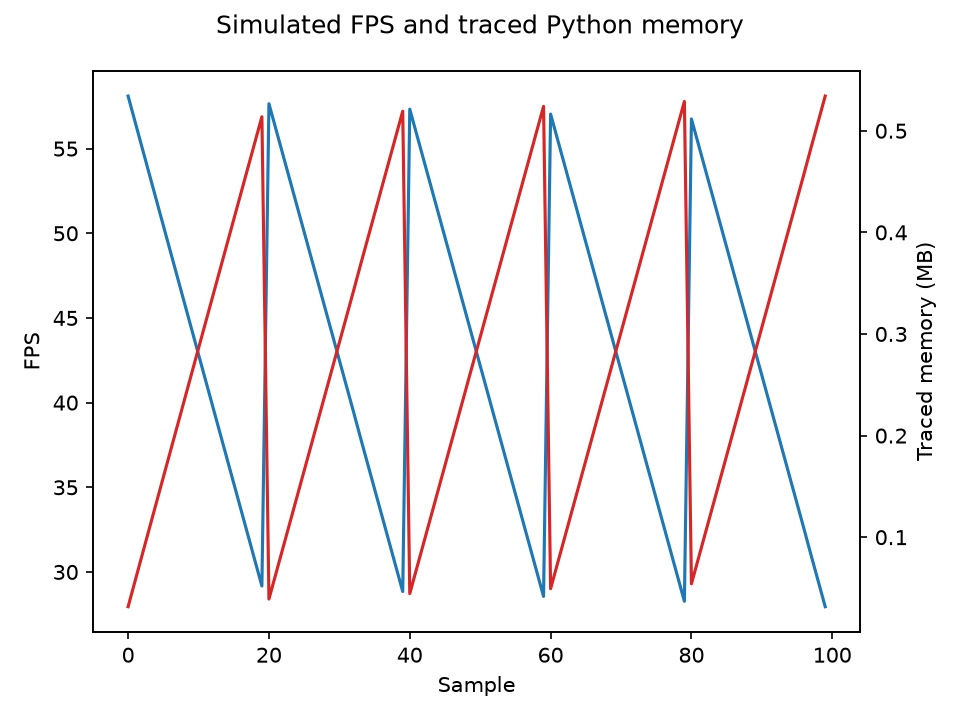

# Лабораторная работа №4 — хранилище FitAI

## Выбор СУБД

Для автономного модуля FitAI выбрана SQLite: база хранится одним файлом рядом с
пользовательскими данными, сервер и сетевое подключение не нужны. При этом
структурированные метрики можно фильтровать, связывать с агентом и агрегировать
SQL-запросами. PostgreSQL был бы оправдан при переходе к совместной работе
пользователей и централизованной облачной аналитике, которых в текущем модуле
нет.

PlayerPrefs и другие key-value хранилища неудобны для таблиц, внешних ключей,
связей и выборок по метрикам. MongoDB здесь избыточна: у телеметрии фиксированные
поля и явная связь с агентом. SQLAlchemy отделяет ORM от доменных моделей,
Alembic версионирует схему и применяет её перед запуском демонстрации.

## Схема и нормализация

Диаграмма сущностей: [`lab4_er_diagram.puml`](./lab4_er_diagram.puml).
Первичная миграция: [`../migrations/versions/0001_initial_schema.py`](../migrations/versions/0001_initial_schema.py).

- `strategies` → `ai_agents`: связь 1:N.
- `ai_agents` → `performance_metrics`: связь 1:N.
- `ai_agents` ↔ `parameter_sets`: связь M:N через `agent_parameter_sets`.
- `parameter_sets` → `parameters`: связь 1:N; ключ параметра уникален внутри набора.
- `player_progress.inventory_json` сохраняет инвентарь как самодостаточную JSON-
  структуру. Это намеренно оставленное исключение из атомарности 1НФ; если
  понадобится искать и агрегировать отдельные предметы, инвентарь следует
  вынести в таблицу `inventory_items`.

У таблицы-связки нет неключевых полей, поэтому частичных зависимостей нет.
Стратегия вынесена в справочник, а параметры — в отдельные таблицы, что исключает
дублирование этих данных в строках агентов. Остальные таблицы имеют атомарные
поля и не содержат транзитивных зависимостей.

## Слои и сохранение

`fitai.domain.repository.IAgentRepository` — контракт хранения; приложение не
импортирует SQLAlchemy. `SqlAgentRepository` открывает короткую сессию на одну
операцию и сохраняет состояние агента по UUID (повторное сохранение обновляет
существующую запись). SQLite включает внешние ключи и WAL.

`BufferedMetricsWriter` принимает измерения в очередь и пишет их отдельным
потоком пачками до 25 записей, по таймеру или при штатном закрытии. `flush()` и
`close()` ожидают завершения записи. Ошибка фоновой записи не теряется: она
передаётся вызывающей стороне при следующей операции писателя.

Принудительное завершение процесса может потерять элементы, которые ещё были в
оперативной очереди. При штатном завершении контекстный менеджер закрывает
писателя и сбрасывает оставшуюся пачку.

Демонстрационный игровой цикл недоступен в исходном FitCalc. Поэтому
`python -m fitai.lab4_demo` запускает локальную симуляцию, а не производственный
инференс: FPS рассчитывается от текущего объёма памяти, выделенного Python и
измеренного через `tracemalloc`. Этот способ измерения отмечен отдельно, чтобы
не выдавать синтетические FPS за реальные показатели ONNX/приложения. Стратегия
читается из БД и меняет действия симуляции.

В проекте нет сборки Unity/IL2CPP или бинарного дистрибутива, поэтому проверка
AOT/link.xml неприменима. Python-зависимости перечислены в `requirements.txt`.

## Запуск и проверка

```bash
python3 -m pip install -r requirements.txt
python3 -m unittest discover -s tests -v
python3 -m fitai.lab4_demo --iterations 100 --plot fps_vs_gc.png
```

По умолчанию файл БД находится в `$XDG_DATA_HOME/fitcalc/fitai.sqlite3` либо
`~/.local/share/fitcalc/fitai.sqlite3`. Для изолированного прогона можно указать
`--database /tmp/fitai-lab4.sqlite3`.

Проверка сохранения и отсутствия дублирования:

```sql
SELECT COUNT(*) FROM performance_metrics;
SELECT COUNT(*) FROM ai_agents;
SELECT a.name, s.type_name
FROM ai_agents a JOIN strategies s ON s.id = a.current_strategy_id;
```

После первого запуска для демонстрации изменения поведения можно обновить
стратегию через SQLite Browser:

```sql
UPDATE ai_agents
SET current_strategy_id = (SELECT id FROM strategies WHERE type_name = 'Voice');
```

Следующий запуск симуляции выводит загруженную стратегию `Voice` и другой набор
действий. Скрипт графика сохраняет `fps_vs_gc.png` и печатает коэффициент
корреляции для измерений конкретного демонстрационного агента.

Результат контрольного запуска на 100 точках:



Для этого симулированного набора коэффициент Пирсона равен **−1.0**. Значение
обусловлено тем, что демонстрационная нагрузка намеренно задаёт FPS как линейно
убывающую функцию от измеренного объёма памяти; это проверка построения графика,
а не вывод о реальной производительности модели.
